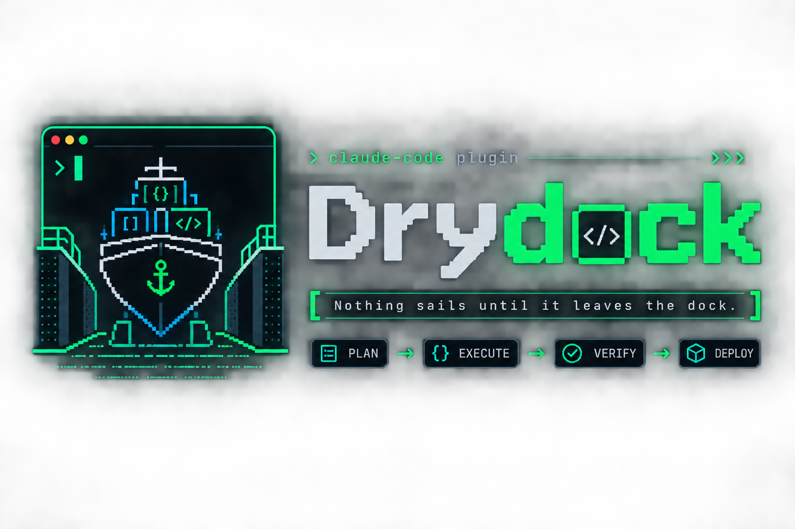

<p align="center">
  
</p>

Drydock keeps an AI agent inside the files you said it may touch. A hook
**denies** Claude Code writes outside a declared set of files, a second hook
**detects** the shell writes it cannot block, and an audit checks the final
diff against the same list. Use it on its own (`/drydock:check`), beside any
planner, as a PR check (`scope-gate`), or with Drydock's own plans when the work
is big enough to split into parallel waves.

**Status: open pilot (v0.21.0).** Every claim is measured in
[compatibility](docs/compatibility.md), including what is not yet shown: so far
it has been run only on this repo, by its author. The guard is observed denying
real edits in live sessions (A6, A12); shell writes are detected, not prevented
(A9). Gate compliance across 5 plans: 28 of 29 wave gates invoked at their
boundary, 1 skipped, and that skip was caught by the next gate. Every session
knew it was observed, so that is a ceiling, not a rate.

**New here? [Quickstart](drydock/QUICKSTART.md).**

Homepage: <https://sandeeptakasi.github.io/drydock/> ·
Plugin: [`drydock/`](drydock/) ·
Reference: [`drydock/README.md`](drydock/README.md)

```
/plugin marketplace add SandeepTakasi/drydock
/plugin install drydock@drydock
```
